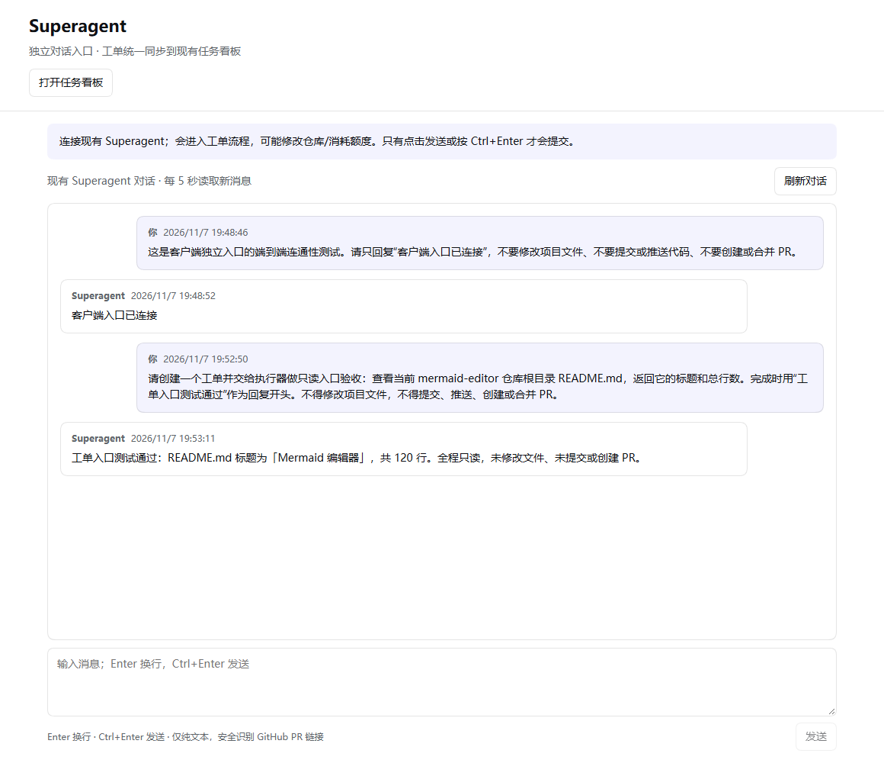
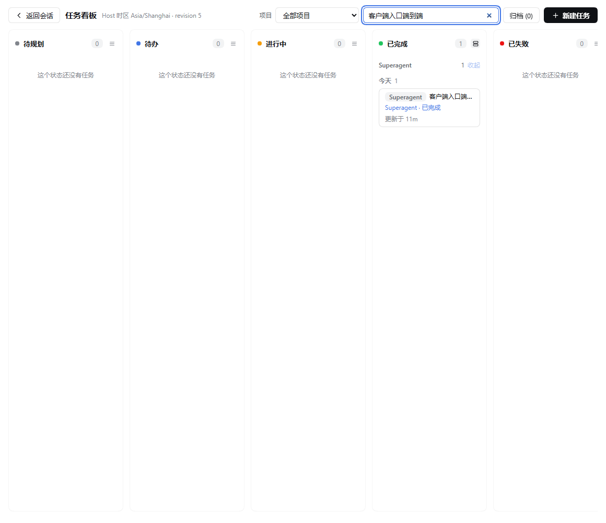

# Superagent Connector

[English](README.en.md) · 简体中文

**在 DSH 客户端直接与 Superagent 对话，让工单出现在已经安装的任务看板里。不是另一套看板。**

- 侧栏 **Superagent**：独立对话入口，连接现有 Superagent，而非普通 DSH 助手代答。
- 侧栏 **任务看板**：复用 `@linxin666/dsh-client-ui-task-board` 的卡片、分列、搜索和详情；显示所有来源的真实 Superagent 工单。
- 工单按 **实例 + 真实 ticket.id** 关联，后续更新原卡，不因重复轮询创建重复卡，也不创建第二套任务台账。
- 真实执行仍由 WSL Superagent 完成。卡片显示来源、阶段、摘要和 PR；本地任务执行器不会再跑同一工单。
- 飞书和 GitHub 原有入口保留；客户端对话走新建的本机 Source，不伪造飞书消息。

> 非官方、早期软件。面向单机、单个 DSH 所有者和单个 Superagent 项目。发出的请求可能按现有配置修改代码、推送和自动合并。请阅读 [SECURITY.md](SECURITY.md)。

## 结构

```text
DSH 客户端
├─ Superagent：直接对话 → 本机 Source → 授权 → 工单 / 执行器 → 回复
└─ 现有任务看板：Superagent provider → 既有卡片和详情
                     ↑ 只同步状态，不在此启动执行器
WSL：现有 dsh-superagent-prototype
```

只有点击发送 / Ctrl+Enter 才提交；Enter 换行。HTTP 202 表示已接收，不表示完成，也不是工单 ID。模型可能直接回答、复用原工单或创建新工单。网络不确定时不自动重发，同 requestId 显式重试由持久化 Trigger 去重。

v0.2 使用一个共享项目对话，按数量和字节预算显示最近消息。工单仍以 Superagent 为事实来源：失败同步保留旧数据，不移成“完成”，也不把离线视为空任务。

## 实际界面

下图来自本机真实验收，不是概念图；原看板截图已筛选为测试工单，避免展示其他工作内容。





## 必需环境

- DSH **0.2.2-rc.1**，Node **22.19+ / 24+**。
- 已安装的任务看板 **`@linxin666/dsh-client-ui-task-board` 0.4.15**。
- 已配置仓库、模型和执行环境的 [Superagent 原型](https://github.com/deepseek-ai/dsh-superagent-prototype)。
- 初始验证组合：Windows DSH desktop + WSL Superagent（`127.0.0.1:3082`）。

无需 `dsh-superagent-panel`、`dsh-superagent-bridge`，也不新增看板页面。

## 为什么有一个兼容补丁？

0.4.15 的公开 provider 接口能同步外部卡片，却没有“由外部执行”的原生执行锁；仅用未知 preset 或隐藏按钮并不能可靠防重。

本仓库因此包含一个**明确、版本锁定、可审阅的宿主侧补丁**：

- 只接受 0.4.15 发布文件的精确 SHA256，否则拒绝修改。
- 在原看板中央 `startRun` 中检查持久化的 Superagent 执行归属；在创建 execution 之前拒绝运行、重跑、返工、定时和含外部卡片的父任务派发。
- 改 preset 或停用 connector 不会取消这条已安装的中央检查。
- 原看板的运行按钮目前仍会显示；点它会收到明确拒绝信息，**不会创建本地执行会话**。请从 Superagent 对话继续任务。
- 不修改 DSH 核心、桌面安装包和 shell；原文件备份在 `$DSH_HOME/superagent-connector-backup`。

这不是已被上游接受的官方接口。升级任务看板前必须重新评估补丁；connector 看不到运行中的 guard 能力标记时不会开始同步。未知 preset 仅作为升级丢失补丁时的额外配置保险，不是安全边界。

## 安装

尚未发布 npm。使用本仓库或 GitHub Release 的归档，不要安装来源不明的同名包。

```bash
pnpm install --frozen-lockfile --ignore-scripts
pnpm check
pnpm pack
```

在原任务看板没有活动 execution 时，先从仓库运行：

```bash
node scripts/install-native-guard.mjs
```

脚本默认读取 `DSH_PROFILE_DIR`（或 `~/.dsh/profiles/desktop`）。随后在 DSH 插件管理器中重新加载原任务看板，加载中央执行保护。

1. 将 connector 归档安装到 Windows 客户端 profile。
2. 把同一归档安装到 WSL Superagent profile，用户覆盖层配置为：

```yaml
- id: superagent-connector
  disabled: true
- id: superagent-desktop-source
  disabled: false
```

3. 创建一个私有 32 字节随机桥接密钥（64 个十六进制字符），相同内容保存到两个用户的私有文件：
   - Windows：`.dsh/superagent-board-token`
   - WSL：`.config/dsh-superagent-board/token`

   文件名沿用原型连接测试版以便升级。密钥不进浏览器、不写命令行参数、不进仓库或聊天，文件应仅供相应 OS 账号读取。
4. Superagent 策略为新来源 `desktop-inbox` 仅允许 `desktop-owner`，不要扩大原飞书/GitHub 名单。
5. 重新加载来源模块，刷新客户端。打开 **Superagent** 对话，或者打开原 **任务看板** 查看带 Superagent 来源标签的卡片。

客户端可覆盖端口和 token 文件：

```yaml
- id: superagent-connector
  config:
    url: http://127.0.0.1:3082
    tokenFile: C:\Users\YOUR_NAME\.dsh\superagent-board-token
```

仅支持固定本机 IPv4 HTTP origin，不提供任意转发、自动启动或重启 WSL 的功能。

## 独立 Agent 名称

v0.3 起，页面不再把 `Superagent` 写死为实例名称，也不把飞书机器人应用名当成 Agent 身份。

- 默认实例名为 **SuperAgent**；展开对话页的 **名称设置**，输入名称后点击保存。
- 名称保存在 WSL Superagent 自身存储中的独立身份记录里；刷新客户端、更新插件或重新加载 Source 后仍保留。
- 侧栏、标题、回复署名及相关提示自动跟随名称更新（可见页面每 15 秒读取；保存成功立即更新当前客户端）。现有看板的来源标签和未冻结卡片标题随下一次同步更新；已有执行历史的冻结标题保留审计记录，不改写。
- 改名不发送聊天消息、不创建 Trigger/工单、不启动执行器，也不更改飞书机器人名、来源 ID 或执行归属。
- 多个客户端同时改名时采用 revision 校验；冲突会保留输入，需要重新读取后显式保存，避免覆盖别人的更名。
- 名称支持 1–80 个 Unicode 字符，作为纯文本显示。离线时保留上次读取的名称；从未读取成功时才用默认名。

此设置当前属于所配置的单个 Superagent 实例。历史消息正文不会被改写；聊天中助手角色的署名使用当前实例名。

## 使用和状态

先用一个只读小任务验证，例如“建立工单，只读查看仓库 README 的标题和行数，不修改、提交、推送或创建 PR”。之后说明目标、范围和验收标准即可。

现有看板中的粗粒度列映射：

| Superagent 状态 | 原看板列 | 细节 |
| --- | --- | --- |
| 工作中 | 进行中 | 实际由 Superagent 执行，不是本机新 execution |
| 排队 | 待办 | 等待原执行器 |
| 等回复、审阅、触发 | 储备 | 具体原因见卡片标签及来源详情 |
| 受阻 / 失败待处理 | 失败 | 工单尚未必结束 |
| 明确完成 / 已合并 | 完成 | 来源结论，不冒充本机执行验收 |
| 关闭 / 停止 / 放弃 / 未知 | 储备 | 不能误标为成功，原始结论保留在来源详情 |

工单摘要和 PR 链接在原详情页的 **Superagent 外部工单**部分。需要继续工作时用对话入口，引用真实工单 ID。归档镜像卡可隐藏它；删除本地镜像不会停止原工单，自动同步仍可能重新导入。不要在本地镜像上安排新运行。

## 开发和迭代

```bash
pnpm check
pnpm pack
```

- `src/client.js`：对话入口，以及原看板卡片 / 详情扩展；没有自建看板。
- `src/taskboard.js`：使用原看板公开 provider face，单飞轮询、稳定 ID、状态同步；不操作其私有 ledger 文件。
- `src/native-guard.js`、`scripts/install-native-guard.mjs`：版本锁定的中央执行保护补丁。
- `src/source.js`：真实 SourceKind，收件箱和回信存于 Superagent 原存储。
- `src/index.js`、`src/upstream.js`、`src/security.js`：真实 DSH 登录鉴权、固定 loopback、分页、大小及时间预算、最小投影和有限脱敏。
- `test/`：单测及可选真实浏览器验收。

两侧归档需同版本。GitHub Issues / PR 用于迭代；不要提交私有配置、凭据、原始工单和私人对话。公开版本带标签和可安装归档，CI 在 Windows / Linux 的 Node 22 / 24 上运行。

## 限制

- 依赖原型 SourceKind 和部分非稳定管理路由，升级必须重新验证。
- 暂无附件、多实例和独立会话列表。所有已登录的本机 DSH 所有者共用同一来源身份，不适合多人租户。
- 本插件不隔离 worker；WSL root 和 GitHub 凭据权限风险仍存在。自动合并规则不由本插件改变。
- 当前为 Superagent → 原看板的单向状态同步；原看板普通新建卡片仍是其原有执行方式，不会悄悄改成交给 Superagent。要向 Superagent 发任务请用独立对话。

MIT。见 [LICENSE](LICENSE)。
