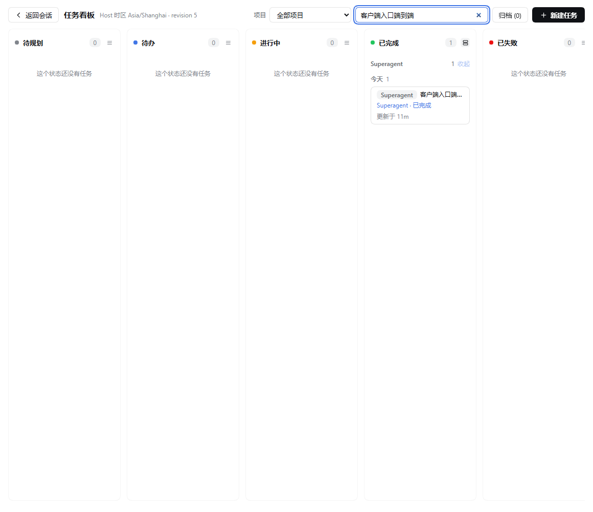
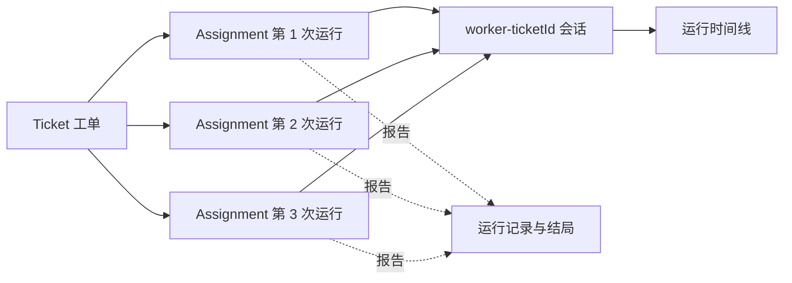
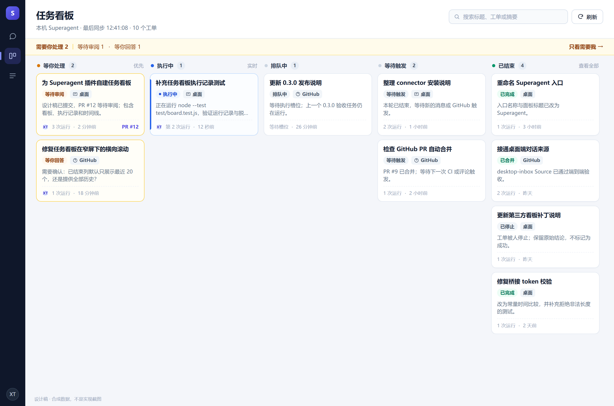
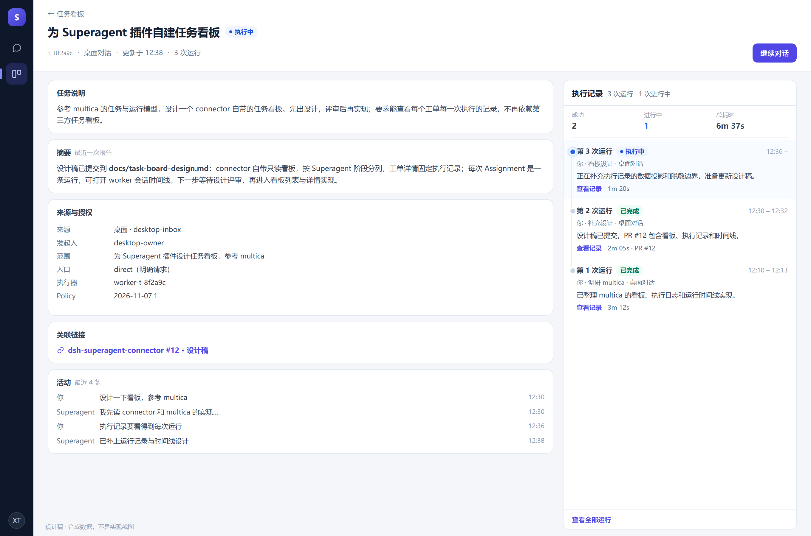
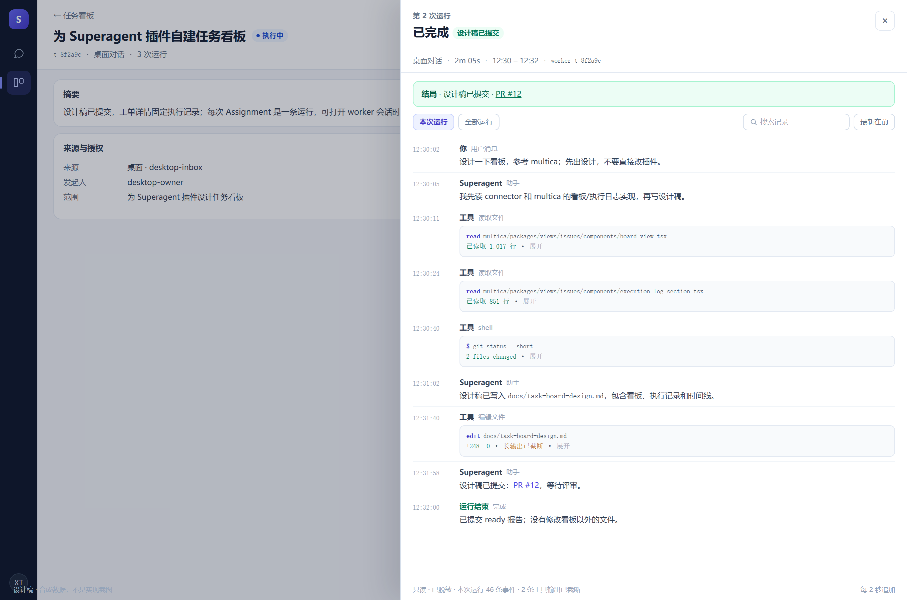

# Superagent 任务看板设计

状态：设计稿，待评审  
目标版本：connector `0.3.0`  
参考：[multica](https://github.com/multica-ai/multica)

## 1. 结论

把「任务看板」从对 `@linxin666/dsh-client-ui-task-board` 的集成，改为 connector 自带的只读面板：

- 侧栏新增 **任务看板**，展示当前 Superagent 实例的全部工单，保留来源标签。
- 看板按 Superagent 的真实阶段分列，不伪造一套本地任务状态。
- 工单详情右侧固定 **执行记录**：每次 Assignment 是一条运行记录，显示触发来源、状态、时间、报告结论和 PR。
- 点「查看记录」打开该工单 worker 会话的运行时间线：消息、工具调用、错误，运行中的记录自动追加。
- Superagent 仍是唯一执行者；看板不创建本地 execution，不另建任务台账。
- 移除版本锁定的宿主补丁和第三方看板依赖。

本设计只覆盖 connector 的桌面端看板；Superagent 自己的 Web 管理面板保持不变。

## 2. 为什么替换现有集成

现有 0.2.2 复用第三方看板，解决了「工单能出现在一个熟悉界面里」，但代价和缺口都很明显：

| 问题 | 影响 |
| --- | --- |
| 依赖第三方看板 `0.4.15` | 对方升级就可能失效；connector 无法独立安装 |
| 需要改写宿主 `startRun` 的版本锁补丁 | 改的是别人的插件文件，升级、回滚和安全审计都更复杂 |
| 卡片只有阶段和摘要 | 看不到一个工单经历过几次运行、每次怎么结束 |
| 外部镜像 + 本地 ledger 并存 | 用户容易把镜像卡当成可本地重跑的任务 |
| 粗粒度列映射（进行中 / 储备 / 失败） | 「等你回复」「等待审阅」「等待触发」全被压成同一列 |

当前 0.2.2 的真实界面（已有验收截图，测试工单已筛选）：



用户要的是「能看到具体任务执行记录」的看板。这正好是 multica 把 **任务（issue）** 和 **运行（run）** 分开的做法，而不是再做一个状态同步镜像。

## 3. 参考 multica 的部分

multica 的相关实现：

- 看板：`packages/views/issues/components/board-view.tsx`、`board-column.tsx`、`board-card.tsx`
- 工单右侧执行日志：`packages/views/issues/components/execution-log-section.tsx`
- 运行时间线：`packages/views/common/task-transcript/run-timeline.tsx`、`build-timeline.ts`
- 运行记录弹窗：`packages/views/common/task-transcript/agent-transcript-dialog.tsx`
- 文档：`apps/docs/content/docs/tasks.zh.mdx`（「任务与运行」「查看执行记录」）

采用的做法：

1. **任务与运行分离**：一个工单可以有很多次执行，旧运行不被覆盖。
2. **执行记录贴着任务**：不是另开一个全局日志页，而是在工单详情右侧固定展示。
3. **进行中的运行置顶**：下面只放最近 3 次已结束运行，更早的进「全部运行」。
4. **运行记录可展开**：消息、工具调用、错误按时间排列；运行中可实时追加，可切换最新在前。
5. **失败和取消不会被写成成功**：运行有自己的结局，工单也有自己的结局。

不照搬的部分：

- 不做多智能体、运行时、成本/Token、计费：Superagent 没有这些概念或没有暴露。
- 不做看板拖拽改状态：状态由 Superagent 决定，拖拽只会制造假象。
- 不做本地停止/重试：connector 只有工单级 `stop`/`retry`，没有运行级控制；v1 保持只读，避免把工单操作伪装成运行操作。
- 不做多实例：仍是单机、单 Superagent 实例。

## 4. 概念映射

| Superagent | 看板 | 说明 |
| --- | --- | --- |
| Ticket | 任务 / 卡片 | 一项被授权的工作 |
| Source（`github` / `feishu` / `desktop-inbox`） | 来源标签与筛选 | 不把不同来源的身份混在一起 |
| `stage` + `action` | 列 + 状态标签 | 见下表 |
| Assignment | 运行记录 | 一次执行器绑定；一个工单可有多条 |
| `assignment.report` | 运行结局与摘要 | `progress` / `waiting` / `ready` / `blocked` / `failed` / `dropped` |
| `latestReport(ticket)` | 卡片摘要 | 最近一次报告，不冒充工单结局 |
| `ticket.attention` | 「等你回答」 | 需要人回答的问题 |
| `ticket.ended.outcome` | 已结束列 | `merged` / `completed` / `stopped` / `dropped` / `closed` |
| `ticket.inputs` | 工单活动 | 人发来的消息、恢复、策略变更等 |
| `ticket.threads` | 关联链接 | PR、Issue、会话 |
| `worker-<ticketId>` 会话 | 运行时间线 | 同一工单的所有运行共用一个 worker 会话 |



### 4.1 列

按工作流从左到右：

| 列 | 条件 | 卡片状态 |
| --- | --- | --- |
| 排队中 | `stage=working, action=queued` | 等待执行槽位 |
| 执行中 | `stage=working` | 实际执行中 |
| 等你处理 | `stage=person` | 审阅 / 回答 / 受阻 / 失败 / 交付失败 |
| 等待触发 | `stage=idle` | 本轮结束，等新消息或触发 |
| 已结束 | `stage=ended` | 合并 / 完成 / 停止 / 放弃 / 关闭 |

「等你处理」列使用强调色，并在看板顶部提供一条「需要你处理 N」的快捷筛选；默认仍按工作流顺序展示，不把看板变成另一个收件箱。

### 4.2 运行结局

| 运行状态 | 显示 |
| --- | --- |
| Assignment `pending` | 排队 |
| Assignment `running`，无报告 | 执行中 |
| `running`，最新报告 `progress` | 执行中 · 有进展 |
| `running`，最新报告非 `progress` 且本轮已结束 | 该报告即本轮结局 |
| Assignment `ended` | 已结束；显示最后报告或 `endedReason` |

Superagent 的 Assignment 是「执行器绑定」，不保证一次运行只有一个模型回合。因此运行记录以 Assignment 为边界，时间线按该运行的 `startedAt` 到 `endedAt`（进行中则到当前）截取；同一工单共用一个会话时，时间窗口是边界，不是独立会话。

## 5. 页面

### 5.1 侧栏

- **Superagent**：现有独立对话入口，保持不变。
- **任务看板**：新增入口，order 排在 Superagent 之后。
- 打开任务看板不启动任何本地执行，也不影响对话入口的草稿。

### 5.2 看板页

```text
┌────────────────────────────────────────────────────────────────────┐
│ 任务看板       本机 Superagent · 最后同步 12:41:08   [刷新] [搜索] │
│ 需要你处理 2 · 进行中 1 · 离线时保留上次数据                        │
├──────────┬──────────┬──────────┬──────────┬──────────────────────┤
│ 等你处理 │ 执行中   │ 排队中   │ 等待触发 │ 已结束               │
│ 2        │ 1        │ 1        │ 2        │ 4                    │
│ ┌──────┐ │ ┌──────┐ │ ┌──────┐ │ ┌──────┐ │ ┌──────┐             │
│ │卡片  │ │ │卡片  │ │ │卡片  │ │ │卡片  │ │ │卡片  │             │
│ └──────┘ │ └──────┘ │ └──────┘ │ └──────┘ │ └──────┘             │
└──────────┴──────────┴──────────┴──────────┴──────────────────────┘
```

卡片内容：

- 标题，最多两行；工单 ID 只在详情显示。
- 来源标签：桌面 / GitHub / 飞书。
- 状态标签：执行中、等待审阅、等你回答、受阻、失败、已合并……
- 最近报告摘要，最多两行；没有报告时显示任务说明。
- 运行次数 `3 次运行`；有进行中运行时显示一个动态点。
- PR 链接用小图标；只有规范 `https://github.com/<owner>/<repo>/pull/<n>` 才渲染成链接。
- 更新时间。

排序：列内按 `updatedAt` 倒序；「等你处理」列内先按 `attention` / `blocked` / `failed` 优先，再按时间。

筛选与搜索：

- 顶部快捷筛选：全部、需要我、进行中、已结束。
- 来源筛选：全部 / 桌面 / GitHub / 飞书。
- 搜索：标题、工单 ID、最近报告摘要；输入即筛，不请求服务端全文索引。
- 已结束列默认最多显示最近 20 个，显示「查看全部 N 个」。

空状态：没有匹配工单时显示当前筛选条件；同步失败时显示「离线，显示上次数据」，**不把失败当空**。

### 5.3 工单详情

从卡片进入，页面替换看板（保留返回按钮），分为左右两栏：

```text
┌──────────────────────────────────────────────────────────────────┐
│ ← 任务看板   为 Superagent 插件自建任务看板        执行中        │
│ 工单 t-8f2a… · 桌面对话 · 更新于 12:38 · 3 次运行 · [继续对话]   │
├───────────────────────────────────┬──────────────────────────────┤
│ 摘要 / 任务说明                   │ 执行记录                     │
│                                   │ 3 次运行 · 1 次进行中         │
│ 来源与授权                        │ ● 第 3 次运行 执行中 12:36   │
│  - 来源：桌面                     │   你 · 看板设计              │
│  - 发起人：desktop-owner          │   1m 20s · 查看记录          │
│  - 范围：…                        │                              │
│  - Policy v…                      │ 第 2 次运行 已完成 12:30     │
│                                   │   你 · 补充设计              │
│ 关联链接                          │   2m 05s · 设计稿已提交      │
│  - PR #12                         │   [查看记录]                 │
│                                   │                              │
│ 活动 / 输入                       │ 第 1 次运行 已完成 12:10     │
│  - 你：开始设计…                  │   …                          │
│                                   │ [查看全部运行]               │
└───────────────────────────────────┴──────────────────────────────┘
```

左栏（主内容）：

- 标题、工单 ID（可复制）、来源、状态、更新时间。
- 需要人处理时，顶部显示问题与「去回答」（打开对话入口，带入工单 ID）。
- 摘要：最近报告全文；过长时折叠。
- 来源与授权：发起人、范围、Policy 版本、入口（mention/direct/follow-up）。
- 关联链接：PR、Issue、飞书会话；只显示安全链接。
- 活动：按时间倒序的输入（人的消息、恢复、策略变更），最多 10 条，更早的折叠。

右栏（执行记录）：

- 标题「执行记录」+ 总运行数。
- 进行中的运行置顶，最多全部展示（通常 1 条）。
- 已结束的运行展示最近 3 条；更早的进入「全部运行」对话框。
- 每条运行显示：序号、状态、触发来源、开始时间、持续时长、报告结局、摘要预览、PR 链接、`查看记录`。
- 没有运行记录时显示「还没有执行记录。等待 Superagent 开始处理。」

### 5.4 运行时间线

「查看记录」打开从右侧滑出的抽屉（窄屏全屏），宽度约 720–760px：

```text
┌──────────────────────────────────────────────────────────────┐
│ 第 2 次运行 · 已完成                             [关闭]      │
│ 桌面对话 · 2m 05s · 12:30 – 12:32 · worker-t-8f2a…           │
│ 结局：设计稿已提交 · PR #12                                  │
│ [本次运行] [全部运行]   [搜索]   [最新在前]                   │
├──────────────────────────────────────────────────────────────┤
│ 12:30:02  你                                                  │
│           设计一下看板，参考 multica                          │
│ 12:30:05  Superagent                                           │
│           我先读 connector 和 multica 的看板实现…             │
│ 12:30:11  工具  读取 multica board-view.tsx                    │
│           已读取 1,017 行                                      │
│ 12:30:40  工具  shell                                          │
│           git status --short                                   │
│ 12:31:02  Superagent                                           │
│           设计稿已写入 docs/task-board-design.md…              │
└──────────────────────────────────────────────────────────────┘
```

- 数据来自该工单的 worker 会话；按事件 `time` 和运行时窗过滤。
- 事件类型：用户消息、助手文本、工具调用、工具结果、错误。省略 reasoning、stream、usage。
- 工具结果默认折叠，显示前 20 行或 4 KB；可展开，展开也受服务端总字节上限。
- 运行中每 2 秒追加新事件；滚动到底部时自动跟随，否则显示「有新记录」。
- 顶部可在「本次运行」与「全部运行」之间切换（同一 worker 会话）；可切换「最新在前」；搜索只过滤当前已加载的事件。
- 底部标注「只读 · 已脱敏 · 显示最近 N 条事件」，有截断时明确说明。

## 6. 数据与接口

### 6.1 现有接口

connector 使用或可以使用的管理接口：

- `GET /orchestrator/api/state`：健康、负载、暂停状态。
- `GET /orchestrator/api/tickets?state=open|ended&offset=…&limit=…`：工单列表（`ticketLine`）。
- `GET /orchestrator/api/tickets/:id`：工单详情（含 assignments、reports、inputs、threads、mandate）。
- `POST /orchestrator/api/tickets/:id/retry|stop`：工单级操作（v1 不使用）。

### 6.2 看板列表

沿用 `GET /@superagent-board/api/board`，扩展投影字段：

```json
{
  "state": { "runtime": "ready", "local": "ready", "running": 1, "queued": 1, "paused": false },
  "items": [{
    "id": "t-8f2a…",
    "title": "为 Superagent 插件自建任务看板",
    "state": "open",
    "stage": "person",
    "action": "review",
    "source": "desktop-inbox",
    "outcome": null,
    "summary": "设计稿已提交，PR #12 等待审阅。",
    "attention": null,
    "runs": { "total": 3, "active": 0 },
    "updatedAt": "2026-11-07T12:38:00.000Z",
    "createdAt": "2026-11-07T12:10:00.000Z",
    "links": [{ "url": "https://github.com/xiaoTN/dsh-superagent-connector/pull/12", "title": "PR #12" }]
  }],
  "total": 10,
  "truncated": false,
  "live": true,
  "fetchedAt": "2026-11-07T12:41:08.000Z"
}
```

新增字段：`source`、`attention`、`runs`、`createdAt`、`links`。`source` 在列表投影中取工单线程的来源（`threads[0].source`），详情中优先用 Mandate 的来源；`summary` 保持最近报告，不拼工单结局；`runs.total` 取 `assignments`，`runs.active` 由 `stage=working` 推导并用于卡片动态点。列表接口不返回每次运行；运行明细只在详情页读取。

### 6.3 工单详情

`GET /@superagent-board/api/tickets/:id`，由 connector 服务端代理并裁剪：

```json
{
  "id": "t-8f2a…",
  "title": "…",
  "state": "open",
  "stage": "working",
  "action": "",
  "source": "desktop-inbox",
  "summary": "…",
  "attention": null,
  "createdAt": "…",
  "updatedAt": "…",
  "mandate": { "actor": "desktop-owner", "scope": "…", "strength": "explicit", "policyVersion": "…", "basis": { "via": "addressed" } },
  "runs": [{
    "id": "a-1",
    "state": "running",
    "createdAt": "…",
    "startedAt": "…",
    "endedAt": null,
    "report": { "state": "progress", "summary": "…", "at": "…" }
  }],
  "inputs": [{ "id": "i-1", "kind": "trigger", "at": "…", "preview": "…" }],
  "links": [{ "url": "https://github.com/…/pull/12", "title": "PR #12" }],
  "runsTruncated": false
}
```

- `runs` 按时间正序返回；前端倒序展示。
- 每份报告摘要最多 8,000 字符；工单的运行最多 50 条，超出 `runsTruncated=true`。
- 输入最多 10 条；更早的只显示数量。
- 不返回 decisions、prompts、settings 等与看板无关的数据。

### 6.4 运行时间线

`GET /@superagent-board/api/tickets/:id/transcript?run=<assignmentId>&after=<seq>&limit=<n>`：

- connector 客户端只请求自己域下的接口，不直接访问 WSL 管理端口。
- 运行在 WSL 的 connector 才能读 worker 会话；Windows 侧 connector 用桥接 token 代理。
- 新增的 WSL 路由（建议 `GET /superagent-desktop-inbox/transcript?ticket=<id>&run=<id>`）：
  - 只接受 `worker-<ticketId>` 会话，工单 ID 必须来自服务端已存在的 ticket；
  - 通过 `ctx.sessionController.inspect(worker-<ticketId>)` 读取事件；
  - 按运行时间窗过滤（`startedAt` 到 `endedAt` 或现在）；
  - 只投影 `user/message`、`assistant/message`、`tool/call`、`tool/result`；
  - 过滤 reasoning、stream、usage；
  - 最多 500 条事件、512 KB，单条文本最多 32 KB；超出返回 `truncated=true`，不静默截断；
  - 所有文本走现有 `redact()`，并额外隐藏桥接 token；
  - 错误只返回稳定错误码，不回显上游响应。
- 运行中的时间线每 2 秒拉取 `after=<最后 seq>`；运行结束后停止轮询。

时间线投影：

```json
{
  "run": "a-1",
  "state": "running",
  "startedAt": "…",
  "endedAt": null,
  "events": [
    { "seq": 12, "at": "…", "type": "user", "text": "设计一下看板…" },
    { "seq": 13, "at": "…", "type": "assistant", "text": "我先读…" },
    { "seq": 14, "at": "…", "type": "tool_call", "callId": "c1", "name": "read", "summary": "读取 board-view.tsx", "detail": "…" },
    { "seq": 15, "at": "…", "type": "tool_result", "callId": "c1", "text": "…", "isError": false, "truncated": true }
  ],
  "truncated": false,
  "next": null
}
```

### 6.5 缓存、轮询与失败

| 数据 | 刷新 | 缓存 |
| --- | --- | --- |
| 看板列表 | 页面可见时 5 秒 | 服务端 1.5 秒 |
| 工单详情 | 打开时 5 秒；已结束工单不轮询 | 无 |
| 运行时间线 | 运行中 2 秒；结束后停止 | 无 |
| 状态/健康 | 随看板列表 | 服务端 1.5 秒 |

- 页面不可见时停止轮询；重新可见时立即刷新。
- 列表刷新失败：保留上次数据，标记离线；不把工单移出列，不把运行标成完成。
- 详情刷新失败：保留已显示内容，提示「更新失败，显示上次数据」。
- 时间线刷新失败：保留已有事件；运行仍在进行时显示重试，不自动重发写操作（本设计没有写操作）。
- 所有请求带超时；上游超时按离线处理，不无限重试。

### 6.6 安全与隐私

沿用 connector 现有边界，不新增浏览器直连：

- 浏览器只访问本机 DSH 的 `/@superagent-board/api/*`，要求同源、`x-superagent-board: 1`、DSH 连接鉴权和 loopback。
- Windows → WSL 继续使用私有桥接 token；不把 token 放进浏览器、URL、命令行参数或日志。
- 看板只读，不新增 `POST` 操作；不改工单、不启动本地 execution。
- 不返回原始上游错误、与工单无关的本地文件列表、环境变量、凭据；时间线只显示该次运行实际调用的文件路径；PR/Issue 链接只接受 `github.com` 和飞书 AppLink 规范链接。
- 时间线读取限制在工单自己的 `worker-<ticketId>` 会话，不接受客户端传入的任意 session id。
- 服务端继续做大小、条数、超时和脱敏限制；前端再做一次展示层脱敏和长度限制。
- 新设计稿使用合成数据；已有验收截图只保留测试工单，不包含真实私人工单内容。

## 7. 视觉

- 使用 DSH 客户端现有的 `--dsw-alias-*` token；亮/暗色跟随主题。
- 中性色为主，状态色只用于状态：执行中蓝、等待琥珀、失败红、完成绿、结束灰。
- 卡片 12px 圆角、1px 边框、无重阴影；列宽约 240–280px，按面板宽度横向滚动。
- 字号：标题 13–14px，元信息 11–12px；看板密度高于普通列表。
- 运行记录用左侧细竖线连接，进行中的运行有脉冲点；不堆叠进度条。
- 空状态、离线状态、截断提示都是文案优先，不加装饰图。

设计稿（合成数据，不是实现截图；源文件见 [design/task-board-mockup.html](design/task-board-mockup.html)）：







## 8. 迁移

### 8.1 移除第三方集成

实现阶段删除：

- `src/taskboard.js`、`src/native-guard.js`、`scripts/install-native-guard.mjs`
- `test/taskboard.test.js` 中与 provider/guard 相关的用例，替换为看板投影测试
- `src/index.js` 的 `taskBoard` 注入和 `registerExtension`
- `src/client.js` 的 `task-board.card.decoration`、`task-board.detail.section`、`registerGrouping`
- README、SECURITY、verification 中「复用现有看板」「安装补丁」的说明

保留：

- 对话入口、`desktop-inbox` Source、桥接 token、loopback/鉴权/脱敏。
- `package.json` 中对 DSH 的版本约束（`engines.dsh`；不再依赖第三方看板）。

### 8.2 旧镜像卡与宿主补丁

第三方看板里已有的 Superagent 镜像卡不会自动消失。迁移顺序必须是：

1. 先上线新看板并验证读数据。
2. 删除旧看板中所有带 `Superagent` 来源的镜像卡；若只归档，必须确认它们不会被恢复后重新运行。
3. 运行实现阶段新增的恢复脚本，把 `$DSH_HOME/superagent-connector-backup` 中的原看板文件还原，移除 central guard。
4. 再移除 connector 的 provider 注册。
5. 用户不再需要第三方看板时，可单独卸载它。

如果先还原补丁再删卡，旧卡会重新变成可本地运行的普通卡，存在重复执行风险；因此顺序不能反。

### 8.3 版本与回滚

- 版本：`0.3.0`（行为变化：不再安装第三方看板集成）。
- 回滚：保留 `0.2.2` 的 tgz 和本设计分支；回滚需要重新安装旧包并重新执行旧补丁脚本。
- 兼容：DSH `>=0.2.2-rc.1 <0.3.0`；不要求安装第三方看板。
- 数据：不新增持久化格式；看板是 Superagent 存储的只读投影。

## 9. 实施拆分

| 阶段 | 内容 | 可验收 |
| --- | --- | --- |
| A | 本设计文档 + 设计稿 | 方向确认 |
| B | 看板列表 + 详情 + 运行记录（无时间线） | 能看到每次运行的结局和报告 |
| C | 运行时间线（只读、限流、脱敏、实时追加） | 能看到消息和工具调用 |
| D | 移除第三方集成、清理补丁、更新文档与测试 | 无第三方看板也能用 |
| E | 0.3.0 打包与真实验收 | Windows 桌面 + WSL 实测 |

建议客户端代码从单文件 `src/client.js` 拆为 `client/` 下的 `board`、`ticket`、`transcript`、`api`、`format` 模块，用 esbuild 打包成现有 `window.__ModuleLoader__.load` 单文件；仓库仍只发布构建产物，不增加运行时依赖。若维护者更倾向零构建，可保留手写 `h()`，但需要接受单文件继续变大。

## 10. 需要确认

设计层面已按 multica 的做法做出选择，以下三点需要产品确认后再进入 B 阶段：

1. **只读范围**：v1 是否保持只读（不做停止/重试）。本设计建议只读，继续工作走对话入口。
2. **结束态保留**：已结束列默认只展示最近 20 个，是否够用，还是需要按时间/来源筛选全部历史。
3. **清理时机**：第三方看板镜像卡和宿主补丁是随 0.3.0 一起清理，还是先并行保留一个版本。本设计建议一起清理，避免两套看板长期并存。

如果这三点没有异议，下一步按 B → C → D 实施。
